<div align="center">

<!-- HERO ANIMADO (vim profile.yml) -->
<a href="https://manuelgonzales.dev/">
  
</a>

<br>

<a href="https://manuelgonzales.dev/">
  
</a>


</div>

---

## `$ whoami`

<p align="center">
  
</p>

<br>

<div align="center">

## `$ cat tech-stack.yaml`

<table border="1" cellpadding="12">
  <thead>
    <tr><th colspan="5" align="left"><code>manuel@lima:~$ cat tech-stack.yaml</code></th></tr>
    <tr><th align="center"><code>├─ lenguajes:</code></th><th align="center"><code>├─ sistemas:</code></th><th align="center"><code>├─ bases_de_datos:</code></th><th align="center"><code>├─ cloud:</code></th><th align="center"><code>╰─ herramientas:</code></th></tr>
  </thead>
  <tbody>
    <tr><td align="center" valign="top"><br><sub><b>C++</b></sub><br><br><br><sub><b>C#</b></sub><br><br><br><sub><b>Python</b></sub></td><td align="center" valign="top"><br><sub><b>Windows</b></sub><br><br><br><sub><b>Linux</b></sub></td><td align="center" valign="top"><br><sub><b>SQL Server</b></sub><br><br><br><sub><b>Azure SQL</b></sub><br><br><br><sub><b>MongoDB</b></sub></td><td align="center" valign="top"><br><sub><b>Azure</b></sub><br><br><br><sub><b>AWS</b></sub></td><td align="center" valign="top"><br><sub><b>Git</b></sub><br><br><br><sub><b>GitHub</b></sub><br><br><br><sub><b>Microsoft 365</b></sub></td></tr>
  </tbody>
  <tfoot>
    <tr><td colspan="5"><code>status: learning&nbsp;&nbsp;·&nbsp;&nbsp;methodologies: Scrum · ITSM</code></td></tr>
  </tfoot>
</table>

</div>

---

## `$ ls ~/certifications`

<div align="center">


<br>


</div>

---

## `$ ls ~/projects`

<table>
  <tr>
    <td width="33%" valign="top">
      <h3>🌐 ProjectVision</h3>
      <sub>Software project developed as part of my academic and personal learning experience.</sub><br><br>
      <br><br>
      <a href="https://github.com/ManuelGY21/ProyectVision"></a>
    </td>
    <td width="33%" valign="top">
      <h3>🔗 LexiConnect</h3>
      <sub>Application developed to strengthen my software development skills and work with structured application logic.</sub><br><br>
      <br><br>
      <a href="https://github.com/ManuelGY21/LexiConnect"></a>
    </td>
    <td width="33%" valign="top">
      <h3>💼 Portfolio</h3>
      <sub>My personal website where I present my profile, projects, skills and professional experience.</sub><br><br>
      <br><br>
      <a href="https://manuelgonzales.dev/"></a>
      <a href="https://github.com/ManuelGY21/Mi-portafolio"></a>
    </td>
  </tr>
</table>

---

## `$ ./skill-radar --scan`

<p align="center">
  <picture>
    <source media="(prefers-color-scheme: dark)" srcset="assets/radar-dark.svg">
    <source media="(prefers-color-scheme: light)" srcset="assets/radar-light.svg">
    
  </picture>
</p>

<p align="center"><sub><code>scan: it_support · networking · cybersecurity · databases · cloud · systems · status: growing</code></sub></p>

---

## `$ cat education.log`

```yaml
degree:     Information Systems Engineering (8th semester) — UPC
period:     2022 — Present
languages:  Spanish (native) · English (B1)
```

---

## `$ connect --socials`

<div align="center">

<sub>Open to IT support, networking and defensive security opportunities — feel free to reach out.</sub>

<br><br>

<a href="https://manuelgonzales.dev/">
  
</a>&nbsp;&nbsp;
<a href="https://www.linkedin.com/in/manuelgonzalesyactayo/">
  
</a>&nbsp;&nbsp;
<a href="mailto:manuelgonzalesyactayo@gmail.com">
  
</a>

</div>

<br>

<div align="center">
<sub>Hecho con 💙 desde Santiago de Surco, Lima, Perú · Manuel Gonzales</sub>
</div>
