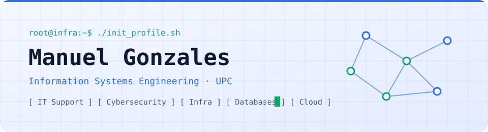
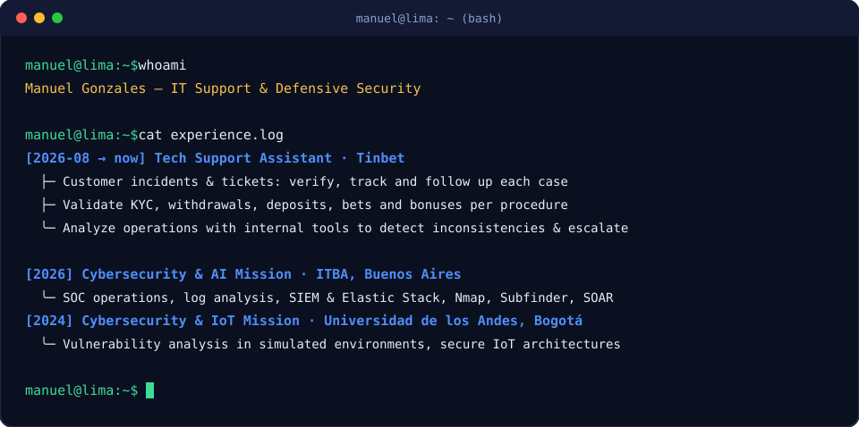
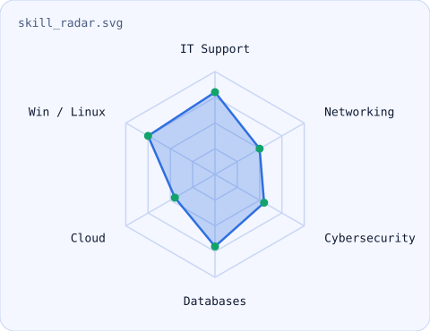

<div align="center">

<!-- BANNER -->
<a href="https://manuelgonzales.dev/">
  <picture>
    <source media="(prefers-color-scheme: dark)" srcset="assets/banner-dark.svg">
    <source media="(prefers-color-scheme: light)" srcset="assets/banner-light.svg">
    
  </picture>
</a>

<br>

<a href="https://manuelgonzales.dev/">
  
</a>


</div>

---

## `$ whoami`

<p align="center">
  
</p>

<br>

<div align="center">

## `$ cat tech-stack.yaml`

<table border="1" cellpadding="14">
  <thead>
    <tr>
      <th colspan="2" align="left"><code>manuel@upc:~$ cat tech-stack.yaml</code></th>
    </tr>
  </thead>
  <tbody>
    <tr>
      <td width="50%" valign="top"><code>├─ 🖥 systems_support:</code><br><br>
        <br>
        <sub><code>Windows · Linux · Ubuntu · Bash · PowerShell</code></sub>
      </td>
      <td width="50%" valign="top"><code>├─ 🌐 networking:</code><br><br>
        
        
        <br>
        <sub><code>TCP/IP · DNS · DHCP · Cisco · Wireshark</code></sub>
      </td>
    </tr>
    <tr>
      <td valign="top"><code>├─ 🛡 cybersecurity:</code><br><br>
        
        <br>
        <sub><code>Security fundamentals · SIEM · Monitoring · Kali Linux</code></sub>
      </td>
      <td valign="top"><code>├─ 🗄 databases:</code><br><br>
        
        <br>
        <sub><code>SQL · SQL Server · MySQL</code></sub>
      </td>
    </tr>
    <tr>
      <td valign="top"><code>├─ ☁ cloud_deploy:</code><br><br>
        <br>
        <sub><code>Azure · AWS · Vercel</code></sub>
      </td>
      <td valign="top"><code>╰─ ✦ dev_tools:</code><br><br>
        <br>
        <sub><code>HTML5 · CSS3 · C# · .NET · Git · GitHub</code></sub>
      </td>
    </tr>
  </tbody>
  <tfoot>
    <tr>
      <td colspan="2"><code>status: learning&nbsp;&nbsp;·&nbsp;&nbsp;environment: UPC → production</code></td>
    </tr>
  </tfoot>
</table>

</div>

---

## `$ ls ~/projects`

<table>
  <tr>
    <td width="33%" valign="top">
      <h3>🌐 ProjectVision</h3>
      <sub>Software project developed as part of my academic and personal learning experience.</sub><br><br>
      <br><br>
      <a href="https://github.com/ManuelGY21/ProyectVision"></a>
    </td>
    <td width="33%" valign="top">
      <h3>🔗 LexiConnect</h3>
      <sub>Application developed to strengthen my software development skills and work with structured application logic.</sub><br><br>
      <br><br>
      <a href="https://github.com/ManuelGY21/LexiConnect"></a>
    </td>
    <td width="33%" valign="top">
      <h3>💼 Portfolio</h3>
      <sub>My personal website where I present my profile, projects, skills and professional experience.</sub><br><br>
      <br><br>
      <a href="https://manuelgonzales.dev/"></a>
      <a href="https://github.com/ManuelGY21/Mi-portafolio"></a>
    </td>
  </tr>
</table>

---

## `$ ./skill-radar --scan`

<p align="center">
  <picture>
    <source media="(prefers-color-scheme: dark)" srcset="assets/radar-dark.svg">
    <source media="(prefers-color-scheme: light)" srcset="assets/radar-light.svg">
    
  </picture>
</p>

<p align="center"><sub><code>scan: it_support · networking · cybersecurity · databases · cloud · systems · status: growing</code></sub></p>

---

## `$ cat education.log`

```yaml
university: Universidad Peruana de Ciencias Aplicadas (UPC)
career:     Information Systems Engineering
period:     March 2022 — Present
focus:      [cybersecurity, databases, software development, technology infrastructure]
```

---

## `$ connect --socials`

<div align="center">

<sub>Open to internships, projects and collaboration — feel free to reach out.</sub>

<br><br>

<a href="https://manuelgonzales.dev/">
  
</a>&nbsp;&nbsp;
<a href="https://www.linkedin.com/in/manuelgonzalesyactayo/">
  
</a>&nbsp;&nbsp;
<a href="mailto:manuelgonzalesyactayo@gmail.com">
  
</a>

</div>

<br>

<div align="center">
<sub>Hecho con 💙 desde Lima, Perú · Manuel Gonzales</sub>
</div>
