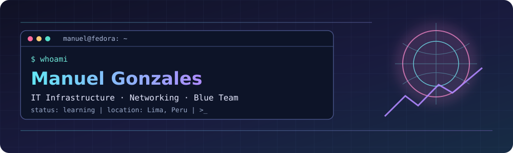

<div align="center">
  

  <a href="https://manuelgonzales.dev/"></a>
  <a href="https://www.linkedin.com/in/manuelgonzalesyactayo/"></a>
  <a href="mailto:manuelgonzalesyactayo@gmail.com"></a>
</div>

---

## `$ whoami`

```yaml
name: Manuel Gonzales
education: Information Systems Engineering @ UPC
location: Lima, Peru
focus:
  - IT infrastructure & technical support
  - Networking & Linux administration
  - Defensive cybersecurity / Blue Team
  - Databases & cloud fundamentals
currently_learning:
  - Network security
  - SIEM & security monitoring
  - Cloud infrastructure
```

I enjoy understanding how systems communicate, troubleshooting infrastructure, and building more secure, reliable technology environments. My background combines **technical support, networking, databases, and software projects**.

## `$ cat tech-stack.yaml`

<table>
<tr><td width="50%" valign="top">

**⌁ Operating systems & support**

  

Troubleshooting · System administration fundamentals

</td><td width="50%" valign="top">

**⌁ Networking & infrastructure**


TCP/IP · DNS · DHCP · Network troubleshooting

</td></tr>
<tr><td valign="top">

**⌁ Security & monitoring**


Cybersecurity fundamentals · SIEM concepts · Security monitoring

</td><td valign="top">

**⌁ Databases & cloud**

 

Relational databases · Cloud fundamentals

</td></tr>
<tr><td colspan="2" valign="top">

**⌁ Software & development tools**

      

</td></tr>
</table>

<sub>Tools shown reflect experience, academic exposure, or current learning—not necessarily professional proficiency in each technology.</sub>

## `$ ls ~/projects`

<table>
<tr><td width="50%" valign="top">

### 🌐 ProjectVision
Academic/personal software project focused on strengthening foundational web development skills.

`HTML` · `CSS` · `Git`

<!-- TODO: Add a verified repository URL for ProjectVision -->

</td><td width="50%" valign="top">

### 🔗 LexiConnect
Application created to practice structured application logic and software development.

`C#` · `.NET` · `GitHub`

<!-- TODO: Add a verified repository URL for LexiConnect -->

</td></tr>
<tr><td colspan="2" valign="top">

### 💼 Personal Portfolio
A personal website showcasing my professional background, projects, and skills.

`HTML` · `CSS` · `Git` · `Vercel`

**[Open website →](https://manuelgonzales.dev/)**

<!-- TODO: Add a verified repository URL for the portfolio -->

</td></tr>
</table>

## `$ cat education.txt`

**Universidad Peruana de Ciencias Aplicadas (UPC)**  
Information Systems Engineering · March 2022 – Present  
Academic interests: cybersecurity, databases, software development, and IT infrastructure.

## `$ connect --socials`

<div align="center">

[**Portfolio**](https://manuelgonzales.dev/) · [**LinkedIn**](https://www.linkedin.com/in/manuelgonzalesyactayo/) · [**Email**](mailto:manuelgonzalesyactayo@gmail.com)

<sub>Built with ☕, curiosity, and a Linux terminal · Lima, Peru</sub>

</div>
